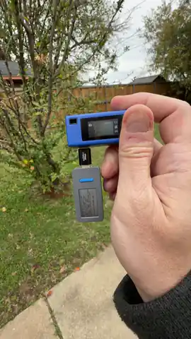
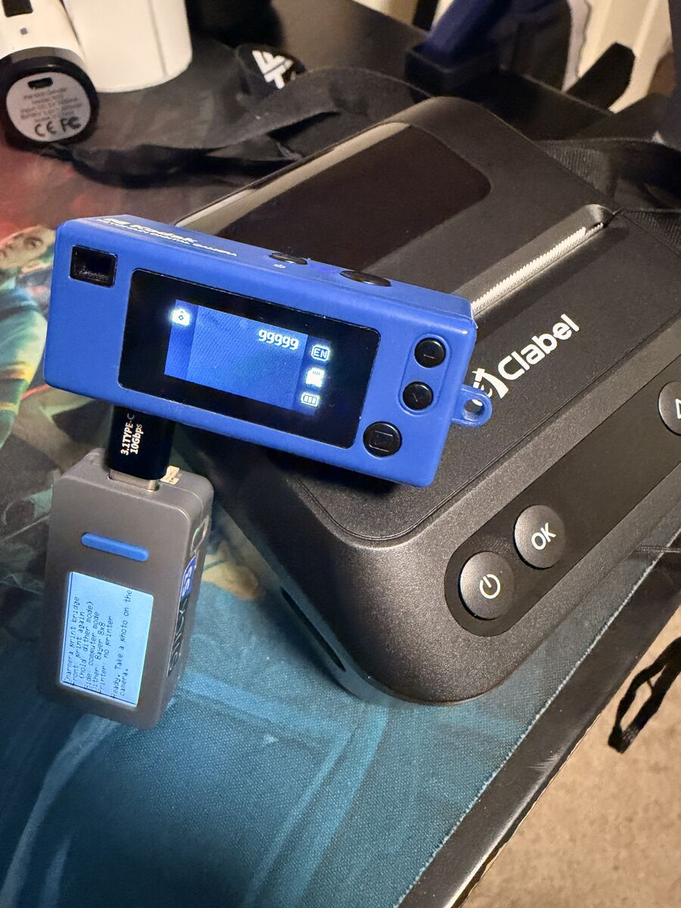

# Charmera Print

Press the shutter on a **Kodak Charmera** keychain camera and the photo comes out of a pocket **Bluetooth thermal printer**, a few seconds later and with no phone in between.

A small **M5Stack StickS3** sits between the two. A plain USB-C cable connects it to the camera. It reads each new photo straight off the camera's card, dithers it, and sends it to whichever supported printer is switched on nearby. There is no pairing and no setup.

```
Charmera ──USB-C──► StickS3 ──Bluetooth──► thermal printer
 (patched)          (bridge)               (any supported one in range)
```

<p align="center">
  
  &nbsp;
  
</p>

> **Unofficial and at your own risk.** This replaces your camera's firmware with a patched copy of the factory firmware. It has worked on our cameras, but a wrong or interrupted flash can leave a camera that needs a hardware programmer to recover. Not affiliated with Kodak, Reto, M5Stack or any printer maker. No camera firmware is included in this repository; you build the update yourself from public images.

## What you need

| Item | Notes |
|---|---|
| [Kodak Charmera](https://www.kodak.com/en/consumer/product/cameras/digital/charmera-keychain-digital-camera/) | Sold as single "blind boxes" from many retailers. |
| [M5Stack StickS3](https://shop.m5stack.com/collections/controllers/STICK) (SKU K150, [docs](https://docs.m5stack.com/en/core/StickS3)) | About US$21. Also at [The Pi Hut](https://thepihut.com/products/m5sticks3-esp32s3-mini-iot-dev-kit) and other M5Stack resellers. |
| USB-C to USB-C cable | Must carry data, not charge-only. Short is best. |
| microSD card | The one in your camera. Formatted **FAT32**; the bridge can't read exFAT. |
| A supported Bluetooth printer | See the next section. |
| A computer | Used once, to build and install both pieces of firmware. |

## Printers

The bridge identifies the printer by its Bluetooth name and services and picks the right protocol, image width and pacing. If several are on, it uses the one you used last, otherwise the closest one.

| Printer | Paper | Tested |
|---|---|---|
| Clabel CT-320B | 80 mm labels | ✅ |
| Clabel CT-230B | 58 mm labels (300 dpi) | ✅ |
| Marklife P50 / P50S | 58 mm | ✅ |
| Phomemo M110 family (shows up as `Phomemo`, `M110`, or a serial like `Q450E…`) | 58 mm | ✅ |
| "Cat printers" (e.g. SC03h, the iPrint/Fun Print kind) | 58 mm | ✅ |
| BX1 (XEasyLabel) | 58 mm | ✅ |
| NETUM NT-861 (advertises as `TM-m30III`) | 80 mm receipts, auto-cut | ✅ |
| POS-8360 type (advertises as `BlueTooth Printer`) | 80 mm receipts, auto-cut | ✅ |
| MXW01 | 58 mm | built, untested |
| Generic 58 mm ESC/POS (MPT-II, or anything advertising service `18F0`) | 58 mm | built, untested |
| **Any other printer** whose name looks like a printer (`print`, `pos`, `receipt`, `thermal`, `label`, …) | printed at 58 mm | fallback: only used if it answers a standard ESC/POS status query |

Not supported yet: Munbyn FM226, Rongta RPP300 (they are recognised and skipped).

## How fast

From the camera appearing on USB to the print starting: about **1–2 seconds**, depending on the printer. That covers 0.1 s to read the photo, 0.4 s to decode, auto-tone and dither it, and 0.5–2.5 s to send it over Bluetooth. Before that, the camera takes a second or two after the shutter to save the photo and present its card.

After each print **the camera switches itself off**. Press its power button once and it comes straight back to the live viewfinder, skipping the mode-select screen. ([Why it has to switch off](docs/HOW-IT-WORKS.md#why-the-camera-switches-off-after-each-print).)

---

## Setup

### 1. Camera: which firmware does yours need?

Charmeras come with one of two image sensors, and each needs a matching firmware build. The colour of the camera and when you bought it don't tell you which.

| Build | Sensor | Base image | Status |
|---|---|---|---|
| `v012` | OmniVision OV9732 | [`charmera-v012-2026-01-12-clean.bin`](https://github.com/the-dumping-grounds/charmera-firmware-v012) | ✅ tested |
| `v006` | SuperPix SP140A | [`charmera-v006-2025-10-14-clean.bin`](https://github.com/the-dumping-grounds/charmera-firmware-v006) | ⚠️ builds cleanly, **never run on a camera** |

**Start with `v012`.** If photo mode then freezes on the "SELECT MODE" screen (shutter sound, no viewfinder), the build doesn't match your sensor. The SD updater still works in that state, so flash the `v006` build instead.

The [charmera-toolkit](https://github.com/daemond-dev/charmera-toolkit) project documents both builds, a sensor-ID probe, backups and [recovery](https://github.com/daemond-dev/charmera-toolkit/blob/main/docs/02-RECOVERY.md). Read its recovery guide before you flash. If you can, back up your camera's own firmware with a CH341A clip first; that is the only way back to exactly what shipped on it.

### 2. Camera: build the update

You need Python 3 and the GNU Arm toolchain (`arm-none-eabi-as`). On macOS: `brew install --cask gcc-arm-embedded`.

```sh
git clone https://github.com/yeahdef/charmera-print && cd charmera-print
curl -LO https://raw.githubusercontent.com/the-dumping-grounds/charmera-firmware-v012/main/charmera-v012-2026-01-12-clean.bin
python3 tools/build_camera_update.py v012 charmera-v012-2026-01-12-clean.bin
```

This writes `build/JH_5408<date>_<checksum>.bin`. The tool checks every byte it patches against what it expects, and refuses a base image from the wrong family or one that has been modified. Don't rename the output: the camera checks the name.

### 3. Camera: install it

1. Charge the camera. Losing power mid-flash is the one way to brick it.
2. Copy the `JH_5408…bin` file to the root of the FAT32 microSD card. Make sure no other `JH_*` file is on it.
3. With the camera **off**, insert the card and switch the camera on. Within a few seconds it shows `Upgrade 0%`, then counts up to `100%` in about 15–20 seconds. Don't touch it meanwhile.
4. At 100% it stays on that screen. Remove the card, then hold power to switch off.
5. **Delete the `JH_` file from the card on a computer.** If you leave it there, the camera re-flashes at every power-on.

The patched camera still works normally on its own. The only difference is that after each photo it briefly offers its card over USB, and if nothing is connected it carries on as usual.

### 4. StickS3: build and install the bridge

Install [arduino-cli](https://arduino.github.io/arduino-cli/latest/installation/) (or use the Arduino IDE with the same board, libraries and settings), then:

```sh
arduino-cli config add board_manager.additional_urls https://static-cdn.m5stack.com/resource/arduino/package_m5stack_index.json
arduino-cli core update-index
arduino-cli core install m5stack:esp32@3.3.10
arduino-cli lib install "M5Unified@0.2.27" "M5GFX@0.2.34" "NimBLE-Arduino@2.5.1" "JPEGDEC@1.8.4"

FQBN=m5stack:esp32:m5stack_sticks3:USBMode=hwcdc,CDCOnBoot=cdc,PSRAM=opi,PartitionScheme=noota_ffat
arduino-cli compile --fqbn $FQBN bridge/charmera_bridge
arduino-cli upload  --fqbn $FQBN -p <port> bridge/charmera_bridge
```

On macOS the port looks like `/dev/cu.usbmodem…`; `arduino-cli board list` shows it. These are the versions this was built and tested with; newer ones will probably work.

**First upload only:** the StickS3's factory firmware doesn't respond to the automatic reset, so put it in download mode by hand ([M5Stack's StickS3 page](https://docs.m5stack.com/en/core/StickS3) shows how), then upload. After that the bridge switches to "computer mode" by itself whenever it's plugged into a computer, so later uploads just work.

## Using it

1. Switch on a printer.
2. Unplug the StickS3 from any computer. It shows "Connecting to the printer…", then a ready screen naming the printer it found.
3. Connect the camera to the StickS3 with the USB-C cable and switch the camera on.
4. Take a photo. It prints, and the camera switches off. Press the camera's power button to shoot again.

**StickS3 buttons**

| Button | Action |
|---|---|
| Front, press | Print the last photo again |
| Front, hold ½ s | Change dithering: Bayer 8×8 (default), Bayer 4×4, error diffusion. Ordered (Bayer) dithering sends about a third as much data, so prints start sooner; error diffusion gives more natural tones. The choice is saved. |
| Side | Computer mode (plugging into a computer does this by itself after a few seconds) |

**Computer mode** gives a serial console (115200 baud) with these single-letter commands:

| Command | Action |
|---|---|
| `d` | Dump the log of the last session: which printer was chosen, and timings for every photo |
| `c` | Clear the log |
| `s` | List the printers in range |
| `n<text>⏎` | Prefer the printer whose name contains `<text>` |
| `m0` / `m1` / `m2` | Dithering: error diffusion / Bayer 4×4 / Bayer 8×8 |
| `v` | Show battery and power |

## Troubleshooting

- **Nothing prints, and the screen says "no printer found":** the printer is off, asleep, or connected to something else. These printers accept one connection at a time and stop advertising while they have one, so close their phone app.
- **The camera doesn't show `Upgrade` at power-on:** the card must be in before switching on, the file must be in the card's root, and its name must be untouched. One of our cameras never accepted updates at all, for reasons we never found.
- **Photo mode freezes on "SELECT MODE":** wrong build for the sensor. Flash the other one (step 1).
- **Prints on a CT-230B come out as garbage:** it is in receipt mode. Toggle it back to label mode (hold power + feed).
- **The bridge can't read the card:** it must be FAT32. The camera can reformat it as exFAT, so reformat it to FAT32 on a computer.

## How it works

[docs/HOW-IT-WORKS.md](docs/HOW-IT-WORKS.md) covers how the camera was patched to talk to the bridge without 5 V on the cable, why it switches off after a print, how the bridge reads the card, and the protocols of every printer family.

## Credits

- The camera work builds on the reverse engineering in [charmera-toolkit](https://github.com/daemond-dev/charmera-toolkit), [keychain-camera-plus](https://github.com/benbadio/keychain-camera-plus) and the public firmware archives at [the-dumping-grounds](https://github.com/the-dumping-grounds).
- The printer protocols, pacing and identification rules were worked out on real hardware for the author's earlier apps, Magic Mate and Matrix Dot Cam, and ported here.
- JPEG decoding by [JPEGDEC](https://github.com/bitbank2/JPEGDEC). Bluetooth by [NimBLE-Arduino](https://github.com/h2zero/NimBLE-Arduino).

## License

MIT, for the code in this repository. Kodak firmware is not included, and is the property of its owners.
